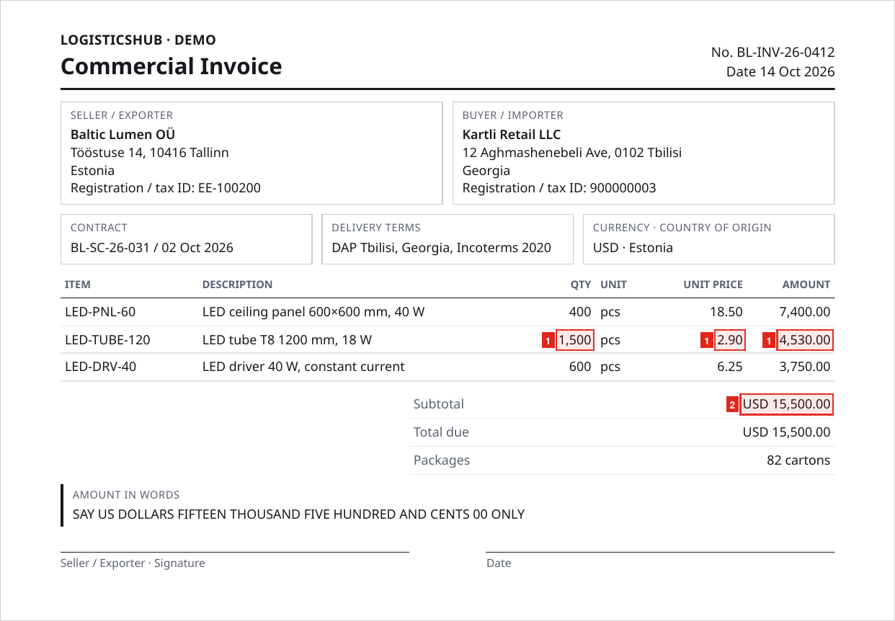

# logisticshub

**AI აგენტის სკილი, რომელიც ერთი ტვირთის სავაჭრო დოკუმენტებს ერთმანეთს ადარებს.** აგენტს მიეცი ერთი ტვირთის კომერციული ინვოისი, შეფუთვის ფურცელი, CMR და ნასყიდობის ხელშეკრულება. მეხუთე დოკუმენტად შეგიძლია დაამატო საქართველოს საქონლის საბაჟო დეკლარაცია. სკილი გიჩვენებს, სად არ ემთხვევა დოკუმენტები ერთმანეთს და სად არის შეცდომა თვითონ დოკუმენტში. ყოველ შეუსაბამობას ზუსტი ციტატა და გვერდის ნომერი ახლავს; იმასაც პოულობს, თუ სიტყვიერად დაწერილი თანხა ციფრებს არ ემთხვევა. ერთი ინვოისის ცალკე შემოწმებაც შეიძლება: მოწმდება სტრიქონების ჯამები, საბოლოო ჯამი და სიტყვიერად დაწერილი თანხა. ანგარიში ქართულად, ინგლისურად, რუსულად ან თურქულად მზადდება.

[სკილის გვერდი](https://tsirbiladze.com/ka/skills/logisticshub) · [English](README.md) · [ცვლილებები](CHANGELOG.md) · MIT

[](https://skills.sh/tsirbiladze/logisticshub)



## დაყენება

აირჩიე ერთ-ერთი.

| სად | როგორ |
|---|---|
| ნებისმიერი აგენტი (Claude Code, Codex, Cursor, Gemini CLI…) | `npx skills@latest add tsirbiladze/logisticshub`, მერე სთხოვე: „შეამოწმე docs/ საქაღალდის დოკუმენტები“ |
| Claude Code-ის plugin | `/plugin marketplace add tsirbiladze/logisticshub`, მერე `/plugin install logisticshub@logisticshub` |
| claude.ai | [ბოლო რელიზიდან](https://github.com/tsirbiladze/logisticshub/releases/latest) ჩამოტვირთე `logisticshub-skill.zip` და ატვირთე *Settings → Capabilities → Skills*-ში. სკილის ინსტრუქციით, claude.ai-ზე Python-ის შემმოწმებელი ეშვება: ანგარიშები იგივეა, მაგრამ PDF-ები არ იკითხება, ამიტომ მონიშნული ასლები არ იქნება და ციტატებიც PDF-ში არ მოწმდება |
| CLI, აგენტის გარეშე | `ANTHROPIC_API_KEY=… npx logisticshub check ./docs`. დოკუმენტებს მოდელი კითხულობს (თუ სხვას არ მიუთითებ, Claude; `--model openai:<id>` ან `openrouter:<id>` შესაბამისი გასაღებით), მერე იგივე შემმოწმებელი მუშაობს. მზა `extraction.json` მოდელისა და გასაღების გარეშე მოწმდება: `npx logisticshub check extraction.json`. პარამეტრები, დასაშვები ფაილები და დასრულების კოდები: [`packages/cli/README.md`](packages/cli/README.md) (ინგლისურად) ან `npx logisticshub --help` |
| MCP სერვერი | `{ "mcpServers": { "logisticshub": { "command": "npx", "args": ["-y", "logisticshub", "mcp"] } } }`. ინსტრუმენტები: `get_extraction_guide` (გზამკვლევი, JSON სქემა და ცარიელი შაბლონი; დეკლარაციისთვის გადაეცი `includeDeclaration: true`), `check_documents` (შემოწმება; `pdfDir`-ით ყოველ ციტატას PDF-ებში ეძებს, `outDir`-ით ანგარიშებს წერს, ორივეს თუ მისცემ, PDF-ებსაც ნიშნავს), `lookup_hs_code` (HS კოდების ძიება) და `lookup_taxpayer` (კომპანიის ცოცხალი ძიება). შენახული ჩანაწერისთვის `check_documents`-ს `registryFile` გადაეცი |

სკილის შემმოწმებელს დაყენება არ სჭირდება. გასაშვებად სჭირდება Node.js 22+ ან Python 3.9+ (`scripts/check.py`). CLI-სა და MCP სერვერს Node.js 22+ სჭირდება.

## რას ამოწმებს

27 დეტერმინისტული წესი. სამი მათგანი რეესტრის შენახულ ჩანაწერს საჭიროებს, ექვსი კი საქართველოს საბაჟო დეკლარაციას ამოწმებს. მოდელი მხოლოდ დოკუმენტებს კითხულობს. არითმეტიკას, სიტყვიერად დაწერილი თანხის წაკითხვასა და ყველა შედარებას კოდი ასრულებს.

| ჯგუფი | წესები |
|---|---|
| თანხები | **AMT-01** თანხა სიტყვიერად = თანხა ციფრებით (KA/EN/RU/TR, ვალუტის ჩათვლით) · **SUM-01** რაოდენობა × ფასი = სტრიქონის ჯამი · **SUM-02** სტრიქონები → საქონლის ღირებულება → საბოლოო ჯამი, ფასდაკლების, ტრანსპორტირების, დაზღვევის, სხვა ხარჯებისა და გადასახადის გათვალისწინებით · **CUR-01** ერთი ვალუტა |
| რაოდენობა და წონა | **SUM-03** შეფუთვის ფურცლისა და CMR-ის სტრიქონების ჯამი მათში ჩაწერილ ჯამს ემთხვევა · **QTY-01** თითოეული პოზიციის რაოდენობა ინვოისსა და შეფუთვის ფურცელში ერთნაირია, ადგილების რაოდენობა კი ინვოისში, შეფუთვის ფურცელსა და CMR-ში · **WGT-01** ბრუტო ≥ ნეტო · **WGT-02** ერთნაირი წონა ყველა დოკუმენტში |
| მითითებები და მხარეები | **REF-01** შეფუთვის ფურცელში ინვოისია მითითებული, ინვოისში ხელშეკრულება, CMR-ის თანდართულ დოკუმენტებში ინვოისი და შეფუთვის ფურცელი წერია, დეკლარაციის გრაფა 44-ში კი ინვოისი · **DATE-01** ხელშეკრულება ≤ ინვოისი ≤ ტვირთის მიღება, ინვოისი ≤ დეკლარაციის რეგისტრაცია · **PTY-01** ერთი და იგივე გამყიდველი, მყიდველი და მიმღები · **PTY-02** ერთნაირი დაბეჭდილი საიდენტიფიკაციო ნომრები · **DOC-01** ნაკრებში თითო ინვოისი, შეფუთვის ფურცელი და CMR არის |
| პირობები და CMR | **INC-01** ინვოისსა და ხელშეკრულებაში Incoterms 2020-ის ერთი და იგივე პირობა · **INC-02** საავტომობილო გადაზიდვისას საზღვაო პირობა არ გამოიყენება · **INC-03** დაზღვევა CIF/CIP პირობით · **CMR-01** CMR კონვენციის მუხ. 6(1)(a)–(k)-ის სავალდებულო მონაცემები |
| საბაჟო კოდები | **HS-01** ინვოისში დაბეჭდილი კოდები საქართველოს სასაქონლო ნომენკლატურაში |
| შემოსავლების სამსახურის ჩანაწერი | **TAX-01** კომპანიის სახელი · **TAX-02** დღგ-ის სტატუსი გადასახადის დარიცხვისას · **TAX-03** პასუხი კოდით −1 |
| საბაჟო დეკლარაცია | **DEC-01** მხარეები · **DEC-02** ეროვნული HS კოდები და პირველი ექვსი ციფრი · **DEC-03** ბრუტო და ნეტო წონა · **DEC-04** ადგილების რაოდენობა · **DEC-05** ინვოისის ვალუტა და ღირებულება · **DEC-06** წარმოშობა |

HS-01 ამოწმებს 2024-01-26-ით ან უფრო გვიან დათარიღებულ ინვოისში დაბეჭდილ HS კოდებს, თუ გამყიდველის, მყიდველის ან მიმღების ქვეყნად საქართველო წერია. თუ კოდი გარკვევით არ იკითხება, მიიღებ გაფრთხილებას. თუ ექვსნიშნა სუბპოზიცია არ მოიძებნა, მიიღებ გაფრთხილებას და უახლოეს სასაქონლო პოზიციას, თუ ის არსებობს. თუ სუბპოზიცია არსებობს, მაგრამ თერთმეტნიშნა კოდი ვერ მოიძებნა, მიიღებ შეცდომას და იმავე სუბპოზიციის მაქსიმუმ ხუთ კოდს. დანარჩენ შემთხვევებში ექვსიდან თორმეტნიშნა კოდის პირველი ექვსი ციფრი მოწმდება.

შემოწმებისა და ძიებისთვის გამოიყენება საქართველოს ფინანსთა მინისტრის 2024 წლის 26 იანვრის №21 ბრძანების დანართის პირვანდელი ტექსტი ([მაწნეს დოკუმენტი 6086072, გამოქვეყნება 0](https://matsne.gov.ge/ka/document/download/6086072/0/1)). ბრძანება იმავე დღეს ამოქმედდა და 2024 წლის 30 იანვარს გამოქვეყნდა. შემდგომი ცვლილებები გადამოწმებული არ არის. საქართველოში ნორმატიული აქტები საავტორო უფლებით არ არის დაცული ([კანონი საავტორო და მომიჯნავე უფლებების შესახებ, მუხ. 8(1)(ა)](https://matsne.gov.ge/ka/document/view/16198)).

ზუსტი კოდით, პირველი ციფრებით ან ქართული აღწერით საძიებლად გამოიყენე `logisticshub hs 940330`, `logisticshub hs "საწერი მაგიდ"`, სკილის `hs` ქვეკომანდა ან MCP ინსტრუმენტი `lookup_hs_code`.

PTY-02 ერთი და იმავე მხარის დაბეჭდილ საიდენტიფიკაციო ნომრებს ციფრებით ადარებს. შემოსავლების სამსახურის შენახული ჩანაწერით TAX-01 ერთი დამწერლობით ჩაწერილ სახელებს ადარებს, TAX-02 გადასახადის დარიცხვისას გამყიდველის დღგ-ის სტატუსს მოთხოვნის მომენტისთვის ამოწმებს, TAX-03 კი პასუხს კოდით −1 სიტყვასიტყვით აჩვენებს.

ერთი კომპანიის მოსაძებნად გაუშვი `logisticshub taxpayer <code>`, ჩანაწერის შესანახად კი `logisticshub registry extraction.json`. შენახული ჩანაწერით შესამოწმებლად გამოიყენე `--registry <file>`, ერთ გაშვებაში გამოსათხოვად და შესამოწმებლად კი `--fetch-registry`. ანგარიშში ჩანს პასუხი, მოთხოვნის დრო და კოდები, რომელთა შემოწმებაც ვერ მოხერხდა.

საქართველოს საქონლის საბაჟო დეკლარაცია შეგიძლია დაამატო პროექტის, რეგისტრირებული ან შეფასებული დოკუმენტის სახით. მოწმდება მხარეები, HS კოდების პირველი ექვსი ციფრი, ტვირთის წონა, შესადარებელი ადგილების რაოდენობა, ინვოისის ვალუტა და თანხა, და ცნობილ ქვეყნებში საქონლის წარმოშობა. მოწმდება დეკლარირებული ეროვნული კოდები და გრაფა 42-ის თანხების ჯამიც. ინვოისის თარიღი რეგისტრაციის თარიღს დარდება, ნომერი კი გრაფა 44-ს.

ყოველი წესის ზუსტი აღწერა (რას პოულობს, რა ითვლება შეცდომად და რა გაფრთხილებად, რა ცდომილებაა დასაშვები): [`skills/logisticshub/references/rules.md`](skills/logisticshub/references/rules.md) (ინგლისურად).

## როგორ მუშაობს

1. **კითხულობს.** აგენტი ყოველ PDF-ს ან გვერდის სურათს კითხულობს და `extraction.json`-ს წერს: ყოველ მონაცემს თავისი მნიშვნელობით, ზუსტი ციტატითა და გვერდის ნომრით.
2. **ამოწმებს.** `scripts/check.mjs` ჯერ თვითონ ამოკითხულ მონაცემებს ამოწმებს: ყოველი რიცხვი და თარიღი თავის ციტატას უნდა შეესაბამებოდეს, ციტატა კი PDF-ის მითითებულ გვერდზე უნდა ეწეროს. მერე დოკუმენტებს წესებით ამოწმებს, ზუსტი ათობითი არითმეტიკით.
3. **გიჩვენებს, სად.** იღებ `report.md`-ს, `report.html`-სა და `report.json`-ს. ყოველ PDF-ს, რომელშიც შეუსაბამობა აღმოჩნდა, ასლიც ექნება, `<სახელი>.marked.pdf`: მასში ყოველი შეუსაბამობა ჩარჩოშია ჩასმული და დანომრილი. თუ შეუსაბამობა არ აღმოჩნდა, მონიშნული PDF არ იქმნება.

შემოსავლების სამსახურის შენახული პასუხის კავშირის გარეშე გადასაყვანად გაუშვი `logisticshub declaration-from-rs response.json`. ერთი დეკლარაციის ასარჩევად გამოიყენე `--registration <number>`, არსებულ მონაცემებთან გასაერთიანებლად კი `--append extraction.json`. ბრძანება შედეგს სტანდარტულ გამომავალ ნაკადში წერს. ეს ქვეკომანდა სკილის ორივე სკრიპტს აქვს.

შემოსავლების სამსახურის შენახულ JSON-ს თავისი ციტატები აქვს. ანგარიშში ჩანს პასუხის ფაილი და JSON-ის საწყისი მნიშვნელობები, გვერდის ნომრის გარეშე. შემმოწმებელი ამ ციტატებს ამოკითხულ მნიშვნელობებს ადარებს. წყარო შენიშვნებშია მითითებული. ამ ფაილს საძიებელი ან მოსანიშნი PDF არ ახლავს.

შეუსაბამობა ანგარიშში ასე გამოიყურება:

```markdown
### 1. SUM-01 · რაოდენობა × ფასი = სტრიქონის ჯამი

სტრიქონი 2: 1 500 × 2,90 = 4 350,00 USD, სტრიქონის ჯამად კი წერია 4 530,00 USD.

- ინვოისი BL-INV-26-0412 (invoice.pdf), გვ. 1 · სტრიქონი 2, რაოდენობა: „1,500“
- ინვოისი BL-INV-26-0412 (invoice.pdf), გვ. 1 · სტრიქონი 2, ერთეულის ფასი: „2.90“
- ინვოისი BL-INV-26-0412 (invoice.pdf), გვ. 1 · სტრიქონი 2, ჯამი: „4,530.00“

→ ინვოისის ეს სტრიქონი თავიდან გადათვალე: რაოდენობა, ფასი ან სტრიქონის ჯამი არასწორია.
```

თუ თვითონ ამოკითხულ მონაცემებში რამეა არასწორი, ეს შეუსაბამობებამდე წერია, სათაურით „ამოკითხვის ხარვეზები“. ანგარიშის შემდეგ სკრიპტი ბეჭდავს `Files:` სიას და, თუ PDF-ების წაკითხვისას რამე გამოჩნდა, `Notes:` სიასაც: რისი მონიშვნა ვერ მოხერხდა და რომელი ციტატა არ წერია იქ, სადაც `extraction.json`-შია მითითებული.

სკრიპტის დასრულების კოდია `0`, თუ დოკუმენტები შემოწმდა, შეუსაბამობა აღმოჩნდა თუ არა; `1`, თუ ამოკითხული მონაცემები გამოუსადეგარია (აკლია ველი, ტიპი არასწორია ან სქემის სხვა ვერსიაა) და ანგარიშში წერია, რა გაასწორო; `2`, თუ არაფერი შემოწმებულა: პარამეტრი არასწორია, `extraction.json` არ იკითხება ან JSON არ არის, რეესტრის ჩანაწერი არ იკითხება ან არასწორია, ან ანგარიშის ჩაწერა ვერ ხერხდება.

სკილის საქაღალდე, [`skills/logisticshub`](skills/logisticshub):

| ფაილი | რა არის |
|---|---|
| `SKILL.md` | ოთხი ნაბიჯი, რომელსაც აგენტი მიჰყვება |
| `references/extraction.md` | როგორ იწერება `extraction.json`: რიცხვები, თარიღები, ციტატები, რამდენიმეგვერდიანი ცხრილები, დასკანერებული გვერდები, ყველა ველი |
| `references/extraction-schema.json` | `extraction.json`-ის JSON სქემა |
| `references/extraction-blank.json` | ცარიელი შაბლონი: ყველა სახის დოკუმენტი და ცხრილის სტრიქონი შეუვსებელი მონაცემებით, გადასაწერად |
| `references/issues.md` | ამოკითხვის ყოველი ხარვეზისა და ყოველი შენიშვნის მნიშვნელობა და ის, რა უნდა გაკეთდეს; აგენტი მხოლოდ მაშინ ხსნის, როცა შემოწმების შემდეგ ხარვეზი ან შენიშვნა ჩნდება |
| `references/declaration.md` | საბაჟო დეკლარაციის გრაფები და ველები. გახსენი, როცა დეკლარაცია ნაკრებშია |
| `references/rules.md` | 27 წესი და ის, რაც არ მოწმდება |
| `scripts/check.mjs` | შემმოწმებელი, HS კოდების ძიება და რეესტრის ბრძანებები, დაყენება არ სჭირდება |
| `scripts/check.py`, `scripts/check-data.json` | იგივე შემმოწმებელი Python-ზე, იქ, სადაც Node.js არ არის |
| `scripts/hs-nomenclature.json.gz` | საქართველოს სასაქონლო ნომენკლატურის მონაცემები ორივე სკრიპტისთვის |
| `scripts/THIRD-PARTY-NOTICES.txt` | იმ ბიბლიოთეკების ლიცენზიები, რომლებიც `check.mjs`-შია ჩაშენებული |

## კონფიდენციალურობა

Logisticshub-ს სერვერი არ აქვს. სკილით მუშაობისას დოკუმენტებს შენი აგენტი თავისი მოდელით კითხულობს, შემოწმება კი იქ ხდება, სადაც აგენტი მუშაობს: შენს კომპიუტერზე, ან claude.ai-ზე, თუ სკილს იქ იყენებ. CLI დოკუმენტებს შენ მიერ არჩეული მოდელის მომწოდებელს უგზავნის, შენი გასაღებით. MCP სერვერით მუშაობისას დოკუმენტებს კლიენტის აგენტი კითხულობს, შემოწმება კი იმ კომპიუტერზე ხდება, რომელზეც სერვერია გაშვებული.

შემმოწმებელი შემოსავლების სამსახურს მხოლოდ მაშინ უკავშირდება, როცა რეესტრში ცოცხალ ძიებას გაუშვებ. xdata.rs.ge-ზე მხოლოდ ქართული კომპანიების 9-ნიშნა კოდები იგზავნება. 11-ნიშნა პირადი ნომერი არასოდეს იგზავნება. შენახული ჩანაწერით ან მის გარეშე შემოწმება კავშირის გარეშე მუშაობს.

## შეზღუდვები

როგორ კითხულობს:

- ერთი გაშვება ერთ ტვირთს ამოწმებს. რამდენიმე ტვირთის დოკუმენტები ცალ-ცალკე უნდა შეამოწმო.
- დასკანერებული გვერდი: გვერდს, რომელსაც ტექსტური ფენა არ აქვს, აგენტი სურათიდან კითხულობს. ასეთ გვერდზე ვერაფერი მოინიშნება და ციტატებიც ვერ გადამოწმდება; ეს შენიშვნებში წერია.
- გვერდების სურათები (JPG, PNG) იკითხება, მაგრამ არასოდეს ინიშნება და მათი ციტატებიც არ მოწმდება.
- სიტყვიერად დაწერილი თანხა ქართულად, ინგლისურად, რუსულად და თურქულად იკითხება. სხვა ენაზე დაწერილზე გაფრთხილებას მიიღებ, რომ თანხის წაკითხვა ვერ მოხერხდა.
- Python-ის შემმოწმებელი იმავე ანგარიშებს წერს, მაგრამ PDF-ებს არ კითხულობს: მონიშნული ასლები არ იქნება და ციტატებიც არ მოწმდება.

არ მოწმდება:

- **Incoterms-ის ადგილი და რედაქცია**: იწერება, მაგრამ არ დარდება. არც ის ფასდება, შეეფერება თუ არა მითითებული ადგილი პირობას.
- **ხელშეკრულების თანხა და საქონელი**: ინვოისის საბოლოო ჯამი ხელშეკრულების თანხას არ დარდება, არც ერთეულის ფასები ხელშეკრულების ფასებს და არც ხელშეკრულების საქონელი ინვოისის სტრიქონებს.
- **მოცულობა დოკუმენტებს შორის**: შეფუთვის ფურცლის მოცულობები მხოლოდ მისსავე ჯამს დარდება, CMR-ს კი არა.
- **სტრიქონების წონა დოკუმენტებს შორის** და ნეტო წონა CMR-ში.
- **სატარიფო კლასიფიკაცია**. HS-01 და DEC-02 დაბეჭდილ კოდებს საქართველოს ნომენკლატურაში ეძებს. საქონლის კლასიფიკაცია და სხვა ქვეყნების ნომენკლატურები შემოწმების ფარგლებს გარეთაა.
- **მისამართები, ქვეყნები, საბანკო რეკვიზიტები, ხელმოწერები და ბეჭდები**. დაბეჭდილი საიდენტიფიკაციო და საგადასახადო ნომრები დოკუმენტებს შორის დარდება. ქვეყნის მიხედვით წყდება, რომელი წესები მოქმედებს. რეესტრის Status, RegisteredSubject, Mortgage, Sequestration, AdditionalStatus და NonResident ველები ანგარიშში უცვლელად ჩანს და მათზე შეფასება არ კეთდება.
- **გადასახადი**: განაკვეთი, ეკუთვნის თუ არა და შედის თუ არა ფასში. დაბეჭდილი თანხა ინვოისის ჯამში შედის. ჩანაწერის არსებობისას TAX-02 გამყიდველის დღგ-ის სტატუსს მოთხოვნის მომენტისთვის ამოწმებს.
- **მხოლოდ პროცენტით მითითებული ფასდაკლება**: ასეთ შემთხვევაში ინვოისის საბოლოო ჯამი არ მოწმდება.
- **ზომის ერთეულები**: არაფერი გადაიანგარიშება. სხვადასხვა ერთეულში მოცემული რაოდენობები არ დარდება, არც ადგილების რაოდენობა, თუ შეფუთვის სახე სხვადასხვაა.
- **სხვა თარიღები**: მიწოდებისა და გადახდის ვადები, მოქმედების ვადა, შეფუთვის ფურცლის თარიღი.
- **ერთი სახის მეორე დოკუმენტი**. ცალკეული შემოწმებები თითოეულ დოკუმენტზე ტარდება. დოკუმენტების შედარებისას ძირითადად თითო სახის პირველი დოკუმენტი გამოიყენება. DEC-02 ყველა ინვოისის HS კოდებს იყენებს, DEC-05 კი ყველა ინვოისის ვალუტასა და ჯამს.
- **სხვა სახის დოკუმენტები**: კონოსამენტი, წარმოშობის სერტიფიკატი, დაზღვევის პოლისი ან სპეციფიკაცია არ იკითხება. მხოლოდ სათაური გამოიყენება, დაზღვევის შესამოწმებლად.
- **დეკლარაციის გაცვლითი კურსი (გრაფა 23)**. ეროვნული ბანკის ოფიციალური კურსის გამოსაყენებელი დღე შემთხვევაზეა დამოკიდებული.
- **დეკლარაციის საბაჟო ღირებულება (გრაფა 46), ბაჟი და გადასახადები**. სერვისის `ValueInGEL` ცალკე იწერება, რადგან აღწერილობაში გრაფა მითითებული არ არის.
- **დეკლარაციის რეჟიმი და პროცედურა**. შემმოწმებელი დაბეჭდილ კოდებს იწერს.
- **ინვოისის სტრიქონების მიკუთვნება დეკლარირებულ საქონელზე**. შემმოწმებელი ჯამებსა და კოდების ნაკრებებს ადარებს.
- **დეკლარაციის ბოლო ვერსია**. შეიძლება არსებობდეს ცვლილება ან შემცვლელი დეკლარაცია.
- **დოკუმენტები და სინამდვილე**: რა საქონელი დაიტვირთა ფაქტობრივად, ნამდვილია თუ არა დოკუმენტი და ხომ არ გამორჩა ამოკითხვისას რამე, რაც დოკუმენტში წერია.

## ხარისხი

- 4 სინთეზური ნაკრები (KA, EN, RU, TR), სულ 45 ვარიანტი: 10 უშეცდომო ნაკრები და 35 ნაკრები განზრახ ჩადებული შეცდომით. მათ შორისაა ორგვერდიანი ინვოისი, დასკანერებული CMR, ორი დოკუმენტი ერთ PDF-ში, მეორე ინვოისი, თარიღები, რომლებშიც თვე დღეზე წინ წერია, და შეფუთვის ფურცელი, რომელშიც რიცხვები ორნაირადაა ჩაწერილი. ახალ ვარიანტებში დეკლარაცია PDF-ით ან შემოსავლების სამსახურის სინთეზური JSON-ითაა მოცემული. ტესტების ყოველი გაშვებისას შემმოწმებელი ზუსტად ჩადებულ შეცდომებს პოულობს და სხვას არაფერს.
- ჩადებული შეცდომები 27 წესიდან 24-ს მოიცავს. SUM-03, CUR-01 და INC-01 წესებისთვის ვარიანტი არ არის: ისინი მხოლოდ წესების ტესტებით მოწმდება.
- Python-ის შემმოწმებლის ანგარიშები Node.js-ისას ბაიტ-ბაიტ ემთხვევა; ეს ყველა ვარიანტზე ოთხივე ენაზე მოწმდება.
- ყოველი წესის ყოველი შეტყობინება ოთხივე ენაზე ტესტით არის შემოწმებული.
- ამ ვერსიის ტესტები Linux-ზე გაეშვა, Node.js 24.22.1-სა და Python 3.14.8-ზე.
- ეს ვერსია ნამდვილ მოდელზე არ გაშვებულა.

### ჯერ არ გვინახავს

2026-11-19-ს შემოსავლების სამსახურის გამოქვეყნებული OpenAPI 1.0.1 აღწერილობის მაგალითით გაგზავნილ ორივე მოთხოვნაზე პასუხი იყო HTTP 200, `Status: -100` და `System error`. წარმატებული პასუხი ცოცხალი სერვისიდან ჯერ არ გვინახავს. კლიენტი გამოქვეყნებულ აღწერილობას მიჰყვება და მხოლოდ ადგილობრივ საცდელ სერვერსა და სინთეზურ ჩანაწერებზე შემოწმდა.

დეკლარაციის გადამყვანი შემოსავლების სამსახურის გამოქვეყნებულ პროტოკოლს (ვერსია 1.0.0, კატალოგის თარიღი 2024-12-31) მიჰყვება. ის სინთეზურ პასუხებზე შემოწმდა. დეკლარაციების ცოცხალ სერვისზე არ გაშვებულა. სერვისში შესვლა და დეკლარაციების ჩამოტვირთვა ამ ინსტრუმენტში არ შედის.

## რეპოზიტორიაზე მუშაობა

```bash
pnpm install
pnpm verify          # ტიპების შემოწმება და ტესტები
pnpm build:skill     # თავიდან აწყობს skills/logisticshub-ს (რეპოზიტორიაში ინახება)
pnpm build:cli       # packages/cli/dist
pnpm fixtures        # თავიდან ქმნის სინთეზურ ნაკრებებსა და PDF-ებს (სჭირდება Chromium და poppler)
```

| საქაღალდე | რა არის |
|---|---|
| `skills/logisticshub` | დასაყენებელი სკილი (აწყობილი, რეპოზიტორიაში ინახება) |
| `packages/core` | სქემა, ამოკითხული მონაცემების შემოწმება, წესები, სიტყვიერი თანხის წამკითხველი, ანგარიშები |
| `packages/annotate` | შეუსაბამობებს PDF-ში ნიშნავს და ციტატებს PDF-ში ეძებს |
| `packages/skill` | SKILL.md-ის წყარო, შემმოწმებელი სკრიპტი, Python-ის ვერსია, სკილის აწყობა |
| `packages/cli` | npm პაკეტი `logisticshub`: CLI და MCP სერვერი |
| `packages/fixtures` | სინთეზური ნაკრებები: აღწერები, შაბლონები, გენერატორი |
| `fixtures` | აწყობილი ნაკრებები: PDF-ები, ყოველი ვარიანტის სანიმუშო `extraction.json` და მოსალოდნელი შეუსაბამობები |
| `docs` | სკილის გვერდის ტექსტი, რომელიც [tsirbiladze.com](https://tsirbiladze.com/ka/skills/logisticshub)-ზე ჩანს |

შენახული დანართიდან ნომენკლატურის მონაცემების ხელახლა ასაწყობად გაუშვი `python3 packages/core/scripts/build-hs-nomenclature.py <annex.docx>`. სკრიპტი ფაილის SHA-256-ს ამოწმებს.

წესები რეპოზიტორიაზე მომუშავე ადამიანებისა და აგენტებისთვის: [AGENTS.md](AGENTS.md) (ინგლისურად).

## ლიცენზია

MIT · ავტორი: [თორნიკე სირბილაძე](https://tsirbiladze.com/ka). სადემო ნაკრებების ყველა კომპანია, პირი და რიცხვი გამოგონილია.
