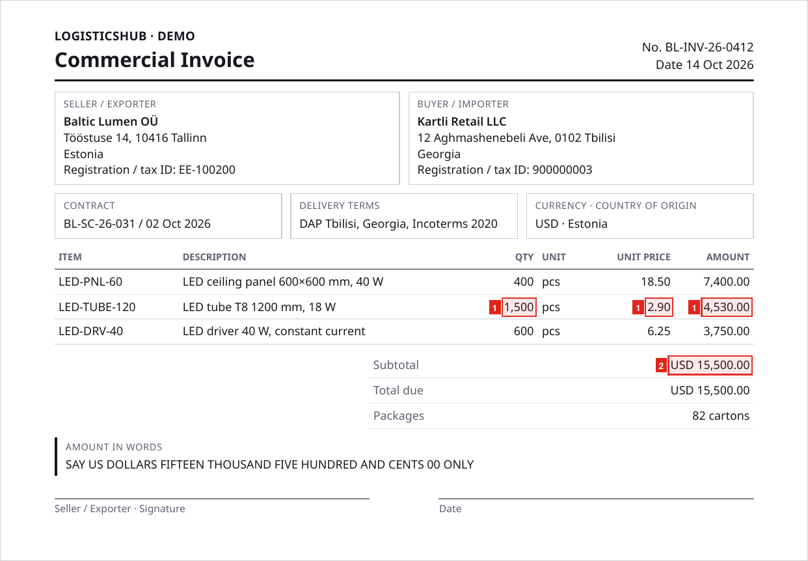

# logisticshub

**An agent skill that cross-checks a shipment's trade documents.** Give your agent the commercial invoice, packing list, CMR and sales contract of one shipment. It reports where they disagree with each other or with themselves, each finding with the exact quote and page, including an amount in words that does not match the figures. One invoice can be checked on its own too: its line totals, its sums and its amount in words. Reports come in English, Georgian, Russian or Turkish.

[Skill page](https://tsirbiladze.com/skills/logisticshub) · [ქართულად](README.ka.md) · [Changelog](CHANGELOG.md) · MIT

[](https://skills.sh/tsirbiladze/logisticshub)



## Install

Pick one.

<details open>
<summary><b>Any agent</b> (Claude Code, Codex, Cursor, Gemini CLI, …)</summary>

```bash
npx skills@latest add tsirbiladze/logisticshub
```

Then ask: *"Check the documents in ./docs for discrepancies."*
</details>

<details>
<summary><b>Claude Code plugin</b></summary>

```
/plugin marketplace add tsirbiladze/logisticshub
/plugin install logisticshub@logisticshub
```
</details>

<details>
<summary><b>claude.ai</b></summary>

Download `logisticshub-skill.zip` from the [latest release](https://github.com/tsirbiladze/logisticshub/releases/latest) and upload it under *Settings → Capabilities → Skills*. On claude.ai the skill's instructions call for its Python checker: the same reports, but the PDFs are not read, so there are no marked copies and no quote is looked up in them.
</details>

<details>
<summary><b>CLI</b>, no agent</summary>

```bash
ANTHROPIC_API_KEY=… npx logisticshub check ./docs
```

A model reads the documents (Claude by default; `--model openai:<id>` or `openrouter:<id>` with that provider's key), then the same checker runs. To check an extraction you already have, no model and no key are needed: `npx logisticshub check extraction.json`. Options, inputs and exit codes: [`packages/cli/README.md`](packages/cli/README.md) or `npx logisticshub --help`.
</details>

<details>
<summary><b>MCP server</b></summary>

```json
{ "mcpServers": { "logisticshub": { "command": "npx", "args": ["-y", "logisticshub", "mcp"] } } }
```

Tools: `get_extraction_guide` (the guide, the JSON Schema and a blank to copy), `check_documents` (the check; with `pdfDir` it looks every quote up in the PDFs, with `outDir` it writes the reports, with both it also marks the PDFs), `lookup_hs_code` (the HS lookup), and `lookup_taxpayer` (a live company lookup). Give `registryFile` to `check_documents` to use a saved snapshot.
</details>

The skill's checker needs Node.js 22+, or Python 3.9+ via `scripts/check.py`. The CLI and the MCP server need Node.js 22+.

## What it checks

21 deterministic rules, including three that read an optional registry snapshot. The model only reads the documents; arithmetic, reading amounts written out in words, and every comparison are done in code.

| Group | Rules |
|---|---|
| Amounts | **AMT-01** amount in words = amount in figures (EN/KA/RU/TR, currency included) · **SUM-01** quantity × price = line total · **SUM-02** line totals → subtotal → total, with discount, freight, insurance, other charges and tax · **CUR-01** one currency |
| Quantities and weights | **SUM-03** packing list and CMR lines add up to their totals · **QTY-01** invoice and packing list give the same quantity per item, and invoice, packing list and CMR the same number of packages · **WGT-01** gross ≥ net · **WGT-02** same weights on every document |
| References and parties | **REF-01** the packing list cites the invoice, the invoice cites the contract, the CMR lists both · **DATE-01** contract ≤ invoice ≤ taking over of the goods · **PTY-01** same seller, buyer and consignee · **PTY-02** same printed identification numbers · **DOC-01** an invoice, a packing list and a CMR, one of each |
| Terms and CMR | **INC-01** one Incoterms 2020 rule on invoice and contract · **INC-02** no sea-only rule on a road shipment · **INC-03** insurance under CIF/CIP · **CMR-01** CMR Convention Art. 6(1)(a)–(k) particulars |
| Customs codes | **HS-01** printed invoice codes in the Georgian commodity nomenclature |
| Revenue Service snapshot | **TAX-01** company name · **TAX-02** VAT payer status when tax is added · **TAX-03** reply with status −1 |

HS-01 checks printed HS codes on invoices dated 2024-01-26 or later when Georgia is the recorded country of the seller, buyer or consignee. An unreadable code gives a warning. A missing six-digit subheading gives a warning and the nearest heading when available. An absent eleven-digit code under a known subheading gives an error and up to five related codes. Other lengths from six to twelve are checked at six digits.

The checker and lookup use the original annex to the Georgian Minister of Finance’s Order No. 21 of 26 January 2024, in force that day and published 30 January 2024 ([Matsne document 6086072, publication 0](https://matsne.gov.ge/ka/document/download/6086072/0/1)). Later amendments were not verified. Normative texts are not protected by copyright in Georgia ([Law on Copyright and Related Rights, Art. 8(1)(a)](https://matsne.gov.ge/ka/document/view/16198)).

Search by exact code, prefix or Georgian description with `logisticshub hs 940330`, `logisticshub hs "საწერი მაგიდ"`, the skill’s `hs` subcommand or the MCP tool `lookup_hs_code`.

PTY-02 compares the digits of printed identification numbers across documents for the same party. With a saved Revenue Service snapshot, TAX-01 compares the company name in the same script, TAX-02 checks whether the seller was listed as a VAT payer at lookup time when the invoice adds tax, and TAX-03 quotes a reply with status −1.

Use `logisticshub taxpayer <code>` for one company or `logisticshub registry extraction.json` to save a snapshot. Check it offline with `--registry <file>` or fetch and check with `--fetch-registry`. The reports display the reply, when it was requested, and any code that could not be checked.

Each rule exactly, with every finding, its severity and its tolerance: [`skills/logisticshub/references/rules.md`](skills/logisticshub/references/rules.md).

## How it works

1. **Read.** Your agent reads each PDF or page image and writes `extraction.json`: every fact with its value, its verbatim quote and its page.
2. **Check.** `scripts/check.mjs` first checks the extraction itself: each number and date must be a reading of its own quote, and each quote must be printed on the PDF page it cites. Then it runs the rules with exact decimal arithmetic.
3. **See where.** You get `report.md`, `report.html` and `report.json`. Each PDF that has a finding also gets a copy, `<name>.marked.pdf`, with every finding boxed and numbered. A run without findings writes no marked PDF.

A finding in the report:

```markdown
### 1. SUM-01 · Quantity × price = line total

Line 2: 1,500 × 2.90 = 4,350.00 USD, but the line total is 4,530.00 USD.

- invoice BL-INV-26-0412 (invoice.pdf), p. 1 · line 2, quantity: “1,500”
- invoice BL-INV-26-0412 (invoice.pdf), p. 1 · line 2, unit price: “2.90”
- invoice BL-INV-26-0412 (invoice.pdf), p. 1 · line 2, total: “4,530.00”

→ Recalculate this line of the invoice: the quantity, the unit price or the line total is wrong.
```

Anything wrong with the extraction itself is listed before the findings, as extraction issues. After the report the script prints `Files:` and, when the PDFs showed something, `Notes:`: what could not be marked, and each quote that is not printed where the extraction says.

The script's exit code is `0` when the documents were checked, with or without findings; `1` when the extraction is not usable (a missing key, a wrong type, another schema version), with reports that list what to fix; `2` when nothing was checked: a bad option, an `extraction.json` that cannot be read or is not JSON, a registry snapshot that cannot be read or is malformed, or reports that cannot be written.

The skill folder, [`skills/logisticshub`](skills/logisticshub):

| File | What |
|---|---|
| `SKILL.md` | the four steps the agent follows |
| `references/extraction.md` | how to write `extraction.json`: numbers, dates, quotes, tables over several pages, scans, every field |
| `references/extraction-schema.json` | the JSON Schema of `extraction.json` |
| `references/extraction-blank.json` | every document type and table line with all facts empty, to copy |
| `references/issues.md` | what each extraction issue and each note means, and what to do; read only when the check lists one |
| `references/rules.md` | the 21 rules, and what is not checked |
| `scripts/check.mjs` | the checker, HS lookup and registry commands, no install |
| `scripts/check.py`, `scripts/check-data.json` | the same checker in Python, for where there is no Node.js |
| `scripts/hs-nomenclature.json.gz` | Georgian commodity nomenclature data shared by both scripts |
| `scripts/THIRD-PARTY-NOTICES.txt` | licenses of what `check.mjs` bundles |

## Privacy

Logisticshub has no server. With the skill, your agent reads the documents with its own model, and the check runs where the agent runs: on your machine, or on claude.ai when you use the skill there. With the CLI, documents go to the model provider you choose, with your key. With the MCP server, the client's agent reads the documents and the check runs on the machine the server runs on.

The checker sends data to the Revenue Service only when you request a live registry lookup. Only 9-digit Georgian company codes go to xdata.rs.ge. An 11-digit personal number is never sent. Checking a saved snapshot or running the checker without one is offline.

## Limits

How it reads:

- One run checks one shipment. The documents of several shipments are checked one run at a time.
- Scans: a page without a text layer is read from its picture. Nothing on it can be marked and no quote on it can be looked up; the notes say so.
- Page images (JPG, PNG) are read, never marked, and their quotes are not looked up.
- An amount in words is read in English, Georgian, Russian and Turkish. In any other language you get a warning that it could not be read.
- The Python checker writes the same reports but reads no PDFs: no marked copies, and no quote is looked up.

Not checked:

- **Incoterms place and edition**: recorded, not compared. Whether the named place suits the rule is not judged.
- **Contract value and goods**: the invoice total against the contract value, unit prices against the contract, the contract's goods against the invoice lines.
- **Volumes across documents**: a packing list's volumes are added up to its own total, not compared with the CMR.
- **Weights per line across documents**, and net weight on a CMR.
- **Origin and tariff classification**: origin is recorded only. Classification, duty and tax calculations, other countries’ nomenclatures and customs declarations are outside the check. HS-01 skips invoices without a confirmed Georgian party or usable date, and invoices dated before 2024-01-26.
- **Addresses, countries, bank details, signatures and stamps**. Printed registration and tax numbers are compared across documents. Country determines which checks apply. Registry Status, RegisteredSubject, Mortgage, Sequestration, AdditionalStatus and NonResident are shown as supplied, without judgment.
- **Tax**: the rate, whether tax is due, and tax included in the prices. A printed tax amount is added into the invoice total. With a registry snapshot, TAX-02 checks the seller’s VAT status at lookup time.
- **A discount printed only as a rate**: the invoice total is then left unchecked.
- **Units**: nothing is converted. Quantities in different units are not compared, and neither are package counts of different packing methods.
- **Other dates**: delivery and payment terms, validity, the packing list's date.
- **Further documents of a type**: a second invoice, packing list, CMR or contract is checked on its own, but the rules that compare documents (QTY-01, WGT-02, REF-01, DATE-01, PTY-01) use the first of each type. The report says when there are more.
- **Other document types**: a bill of lading, certificate of origin, insurance policy or specification is not read. Only its title counts, for the insurance check.
- **The documents against reality**: the goods actually loaded, whether a document is genuine, and whether the extraction left out something the document prints.

## Quality

- 4 synthetic packs (KA, EN, RU, TR) with 36 variants: 8 sets without a problem and 28 with a planted one. Among them are an invoice over two pages, a scanned CMR, two documents in one PDF, a second invoice, dates written month first, and a packing list that prints numbers in two conventions. The checker reports exactly the planted findings and nothing else, on every test run.
- The planted problems cover 18 of the 21 rules. SUM-03, CUR-01 and INC-01 have no variant: they are covered by the rule tests alone.
- The Python checker produces byte-identical reports to the Node one, tested on every variant in all four languages.
- Every message of every rule is tested in all four languages.
- This version’s suite ran on Linux with Node.js 24.22.1 and Python 3.14.8.

### Not yet seen

On 2026-11-19, both live requests to the Revenue Service made with the example in its published OpenAPI 1.0.1 description returned HTTP 200 with `Status: -100` and `System error`. No successful live response was seen. This implementation follows the published description and was tested with a local HTTP stub and synthetic snapshots only.

## Development

```bash
pnpm install
pnpm verify          # typecheck + tests
pnpm build:skill     # rebuilds skills/logisticshub (committed)
pnpm build:cli       # packages/cli/dist
pnpm fixtures        # regenerates the synthetic packs and PDFs (needs Chromium and poppler)
```

| Path | What |
|---|---|
| `skills/logisticshub` | the installable skill (built, committed) |
| `packages/core` | schema, extraction check, rules, amount-in-words parser, reports |
| `packages/annotate` | marks findings on PDFs and looks quotes up in them |
| `packages/skill` | SKILL.md source, the check script, Python port, skill build |
| `packages/cli` | the `logisticshub` npm package: CLI and MCP server |
| `packages/fixtures` | synthetic packs: specs, templates, generator |
| `fixtures` | the generated packs: PDFs, a reference `extraction.json` and the expected findings of each variant |
| `docs` | the skill page text shown on [tsirbiladze.com](https://tsirbiladze.com/skills/logisticshub) |

Rebuild the nomenclature from the saved annex with `python3 packages/core/scripts/build-hs-nomenclature.py <annex.docx>`. The build script verifies its SHA-256.

Contributor notes for people and agents: [AGENTS.md](AGENTS.md).

## License

MIT · made by [Tornike Sirbiladze](https://tsirbiladze.com). All companies, people and numbers in the demo packs are fictional.
