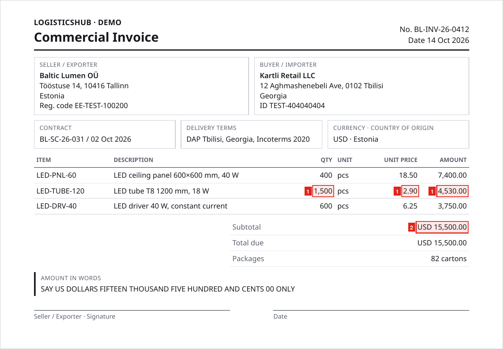

## რას აკეთებს

`logisticshub` ერთი ტვირთის დოკუმენტებს (კომერციულ ინვოისს, შეფუთვის ფურცელს, CMR-სა და ნასყიდობის ხელშეკრულებას) ერთმანეთს ადარებს და თითოეულს ცალკეც ამოწმებს. ყოველ შეუსაბამობას, რომელსაც მისი წესები პოულობს, ზუსტი ციტატითა და გვერდის ნომრით გიჩვენებს.

დოკუმენტს არასოდეს ასწორებს და არაფერს ვარაუდობს. შენი აგენტი მხოლოდ კითხულობს: ყოველი PDF-იდან ან გვერდის სურათიდან თითოეულ მონაცემს ზუსტად ისე იწერს, როგორც დოკუმენტში წერია, ციტატასთან და გვერდის ნომერთან ერთად. დანარჩენს კოდი აკეთებს. შემმოწმებელი ჯერ იმას ადგენს, ყოველი რიცხვი და თარიღი თავის ციტატას შეესაბამება თუ არა და ციტატა მართლა წერია თუ არა მითითებულ გვერდზე. ამის შემდეგ ჯამებს ზუსტი ათობითი არითმეტიკით ითვლის, სიტყვიერად დაწერილ თანხას (ქართულად, ინგლისურად, რუსულად, თურქულად) რიცხვად აქცევს და დოკუმენტებს 16 ფიქსირებული წესით ამოწმებს. ერთსა და იმავე მონაცემებზე ორჯერ რომ გაუშვა, ორივეჯერ ერთსა და იმავე ანგარიშს მიიღებ.

შედეგად იღებ ანგარიშს Markdown, HTML და JSON ფორმატში, ქართულად, ინგლისურად, რუსულად ან თურქულად. ყოველ შეუსაბამობასთან წერია დოკუმენტი, გვერდი, ველი და ციტატა, ბოლოს კი ის, რა უნდა გადაამოწმო. თუ რომელიმე PDF-ში შეუსაბამობა აღმოჩნდა, მის ასლსაც იღებ, რომელშიც შეუსაბამობები ჩარჩოშია ჩასმული და დანომრილი.

## როდის გამოიყენო

აგენტს უბრალოდ სთხოვე: „შეამოწმე ამ საქაღალდის დოკუმენტები“ ან „ინვოისი და CMR ერთმანეთს ემთხვევა?“. სკილი ერთი ტვირთის საექსპორტო ან საბაჟო დოკუმენტების შესამოწმებლადაა. ერთი ინვოისის ცალკე შემოწმებაც შეიძლება: მოწმდება სტრიქონების ჯამები, საბოლოო ჯამი და სიტყვიერად დაწერილი თანხა. ინვოისის გადასახდელად ან ბუღალტერიაში გასატარებლად არ გამოდგება.

| როდის | რას პოულობს |
|---|---|
| ტვირთის გაგზავნამდე | ინვოისში, შეფუთვის ფურცელსა და CMR-ში რაოდენობა, ადგილების რაოდენობა ან წონა ერთმანეთს არ ემთხვევა |
| დოკუმენტების ბანკში ან მყიდველთან გაგზავნამდე | სიტყვიერად დაწერილი თანხა ციფრებს არ ემთხვევა; სტრიქონის ჯამი ან საქონლის ღირებულება არასწორადაა დათვლილი |
| საბაჟო გაფორმებამდე | CMR-ს სავალდებულო მონაცემები აკლია; საავტომობილო გადაზიდვისას საზღვაო პირობაა მითითებული; CIF ან CIP პირობისას არც დაზღვევის პოლისია და არც დაზღვევის თანხა |
| მომწოდებლის გამოგზავნილი დოკუმენტების გადახედვისას | დოკუმენტებს შორის მითითება არასწორია ან გამოტოვებულია; თარიღების თანმიმდევრობა დარღვეულია; გამყიდველი ან მყიდველი სხვადასხვანაირად წერია |

## რას ამოწმებს

- **თანხები.** სიტყვიერად დაწერილი თანხა ციფრებით დაწერილს უდრის და ვალუტაც იგივეა. რაოდენობა × ფასი ყოველი სტრიქონის ჯამს უდრის. სტრიქონების ჯამი საქონლის ღირებულებას უდრის, საქონლის ღირებულება კი ფასდაკლების, ტრანსპორტირების, დაზღვევის, სხვა ხარჯებისა და გადასახადის გათვალისწინებით საბოლოო ჯამს იძლევა. ინვოისსა და ხელშეკრულებაში ვალუტა ერთია.
- **რაოდენობა და წონა.** შეფუთვის ფურცლისა და CMR-ის სტრიქონების ჯამი მათში ჩაწერილ ჯამს ემთხვევა. თითოეული პოზიციის რაოდენობა ინვოისსა და შეფუთვის ფურცელში ერთნაირია, ადგილების რაოდენობა კი ინვოისში, შეფუთვის ფურცელსა და CMR-ში. ბრუტო წონა ნეტოზე ნაკლები არ არის, წონა კი ყველა დოკუმენტში ერთნაირია.
- **მითითებები და მხარეები.** შეფუთვის ფურცელში ინვოისის ნომერი და თარიღი სწორად წერია, ინვოისში კი ხელშეკრულებისა; CMR-ის თანდართულ დოკუმენტებში ინვოისიც წერია და შეფუთვის ფურცელიც. ხელშეკრულების თარიღი ≤ ინვოისის თარიღი ≤ ტვირთის მიღების თარიღი. გამყიდველი, მყიდველი და მიმღები ყველა დოკუმენტში ერთი და იგივეა. ნაკრებში ინვოისიც არის, შეფუთვის ფურცელიც და CMR-იც.
- **პირობები და CMR.** ინვოისსა და ხელშეკრულებაში Incoterms 2020-ის ერთი და იგივე პირობა წერია; საავტომობილო გადაზიდვისას საზღვაო პირობა არ გამოიყენება; CIF ან CIP პირობისას დოკუმენტებში დაზღვევა ჩანს; CMR-ში წერია ყველა მონაცემი, რომელსაც CMR კონვენციის მუხ. 6(1)(a)–(k) მოითხოვს.

ყოველი წესი ზუსტად არის აღწერილი [წესების ცნობარში](https://github.com/tsirbiladze/logisticshub/blob/main/skills/logisticshub/references/rules.md) (ინგლისურად): რას პოულობს, რა ითვლება შეცდომად და რა გაფრთხილებად, რა ცდომილებაა დასაშვები.

## როგორ მიხვდე, რომ სწორად მუშაობს

- ყოველი შეუსაბამობის ციტატას სიტყვასიტყვით იპოვი იმ გვერდზე, რომელიც ანგარიშშია მითითებული.
- თუ დოკუმენტები ერთმანეთს ემთხვევა, პასუხია „შეცდომა: 0 · გაფრთხილება: 0“ და არა წვრილმანების სია.
- ერთსა და იმავე მონაცემებზე ხელახლა რომ გაუშვა, იმავე ანგარიშს მიიღებ.
- თუ რამე გარკვევით არ იკითხება (მაგალითად, სიტყვიერ თანხაში შეცდომაა), ვარაუდის ნაცვლად გაფრთხილებას მიიღებ.
- თუ აგენტმა ციტატა ან გვერდის ნომერი არასწორად ჩაწერა, ეს შეუმჩნეველი არ რჩება: ყოველი ციტატა, რომელიც PDF-ის მითითებულ გვერდზე ვერ მოიძებნა, ანგარიშის შემდეგ არის ჩამოთვლილი.

## შეზღუდვები

როგორ კითხულობს:

- ერთი გაშვება ერთ ტვირთს ამოწმებს. რამდენიმე ტვირთის დოკუმენტები ცალ-ცალკე უნდა შეამოწმო.
- დასკანერებული გვერდი: გვერდს, რომელსაც ტექსტური ფენა არ აქვს, აგენტი სურათიდან კითხულობს. ასეთ გვერდზე ვერაფერი მოინიშნება და ციტატებიც ვერ გადამოწმდება; ეს შენიშვნებში წერია.
- გვერდების სურათები (JPG, PNG) იკითხება, მაგრამ არასოდეს ინიშნება და მათი ციტატებიც არ მოწმდება.
- სიტყვიერად დაწერილი თანხა ქართულად, ინგლისურად, რუსულად და თურქულად იკითხება. სხვა ენაზე დაწერილზე გაფრთხილებას მიიღებ, რომ თანხის წაკითხვა ვერ მოხერხდა.
- Python-ის შემმოწმებელი იმავე ანგარიშებს წერს, მაგრამ PDF-ებს არ კითხულობს: მონიშნული ასლები არ იქნება და ციტატებიც არ მოწმდება.

არ მოწმდება:

- **Incoterms-ის ადგილი და რედაქცია**: იწერება, მაგრამ არ დარდება. არც ის ფასდება, შეეფერება თუ არა მითითებული ადგილი პირობას.
- **ხელშეკრულების თანხა და საქონელი**: ინვოისის საბოლოო ჯამი ხელშეკრულების თანხას არ დარდება, არც ერთეულის ფასები ხელშეკრულების ფასებს და არც ხელშეკრულების საქონელი ინვოისის სტრიქონებს.
- **მოცულობა დოკუმენტებს შორის**: შეფუთვის ფურცლის მოცულობები მხოლოდ მისსავე ჯამს დარდება, CMR-ს კი არა.
- **სტრიქონების წონა დოკუმენტებს შორის** და ნეტო წონა CMR-ში.
- **წარმოშობის ქვეყანა და HS კოდები**: მხოლოდ იწერება. არც სატარიფო კლასიფიკაცია ხდება, არც ბაჟისა და გადასახადის გამოთვლა, არც საბაჟო დეკლარაციის შევსება.
- **მისამართები, ქვეყნები, საიდენტიფიკაციო და საგადასახადო ნომრები, საბანკო რეკვიზიტები, ხელმოწერები და ბეჭდები**. მხარეების მხოლოდ სახელები დარდება; სხვადასხვა დამწერლობით დაწერილი სახელები კი არა.
- **გადასახადი**: არ მოწმდება განაკვეთი, არც ის, ერიცხება თუ არა გადასახადი საერთოდ, და არც ფასში ჩათვლილი გადასახადი. ინვოისში დაწერილი გადასახადის თანხა მხოლოდ საბოლოო ჯამის გამოთვლისას გამოიყენება.
- **მხოლოდ პროცენტით მითითებული ფასდაკლება**: ასეთ შემთხვევაში ინვოისის საბოლოო ჯამი არ მოწმდება.
- **ზომის ერთეულები**: არაფერი გადაიანგარიშება. სხვადასხვა ერთეულში მოცემული რაოდენობები არ დარდება, არც ადგილების რაოდენობა, თუ შეფუთვის სახე სხვადასხვაა.
- **სხვა თარიღები**: მიწოდებისა და გადახდის ვადები, მოქმედების ვადა, შეფუთვის ფურცლის თარიღი.
- **ერთი სახის მეორე დოკუმენტი**: მეორე ინვოისი, შეფუთვის ფურცელი, CMR ან ხელშეკრულება ცალკე მოწმდება, მაგრამ წესები, რომლებიც დოკუმენტებს ერთმანეთს ადარებს (QTY-01, WGT-02, REF-01, DATE-01, PTY-01), თითოეული სახის პირველ დოკუმენტს იყენებს. თუ ერთი სახის რამდენიმე დოკუმენტია, ანგარიშში ეს წერია.
- **სხვა სახის დოკუმენტები**: კონოსამენტი, წარმოშობის სერტიფიკატი, დაზღვევის პოლისი ან სპეციფიკაცია არ იკითხება. მხოლოდ სათაური გამოიყენება, დაზღვევის შესამოწმებლად.
- **დოკუმენტები და სინამდვილე**: რა საქონელი დაიტვირთა ფაქტობრივად, ნამდვილია თუ არა დოკუმენტი და ხომ არ გამორჩა ამოკითხვისას რამე, რაც დოკუმენტში წერია.

## გაშვების სამი გზა

გაშვების სამი გზა არსებობს და სამივე ერთსა და იმავე შემმოწმებელს იყენებს:

- **სკილი** შენს აგენტში მუშაობს (Claude Code, Codex, Cursor, claude.ai და სხვები). დოკუმენტებს აგენტი თავისი მოდელით კითხულობს, შემოწმება კი იქ ხდება, სადაც აგენტი მუშაობს: შენს კომპიუტერზე ან claude.ai-ზე, სადაც, სკილის ინსტრუქციით, Python-ის შემმოწმებელი ეშვება.
- **CLI** (`logisticshub` npm-ზე) დოკუმენტებს შენ მიერ არჩეული მოდელით კითხულობს, შენი API გასაღებით; თითო ფაილში თითო დოკუმენტი უნდა იყოს. უკვე ამოკითხულ მონაცემებს მოდელის გარეშეც ამოწმებს. გამოიყენე სკრიპტებში ან მაშინ, როცა აგენტი არ გაქვს.
- **MCP სერვერი** (`logisticshub mcp`) ნებისმიერ MCP კლიენტს ორ ინსტრუმენტს აძლევს: ამოკითხვის გზამკვლევსა და შემოწმებას.

სკილის შემმოწმებელიც და CLI-ც მუშაობას ერთი და იმავე კოდებით ამთავრებს: 0, თუ დოკუმენტები შემოწმდა, შეუსაბამობა აღმოჩნდა თუ არა; 1, თუ შემოწმება არასრულია და მიზეზი ანგარიშში წერია; 2, თუ არაფერი შემოწმებულა.

Logisticshub-ს სერვერი არ აქვს, ამიტომ მას არაფერი ეგზავნება. CLI-ით მუშაობისას დოკუმენტები შენ მიერ არჩეული მოდელის მომწოდებელს ეგზავნება. სადემო დოკუმენტების ყველა კომპანია, პირი და რიცხვი გამოგონილია.
