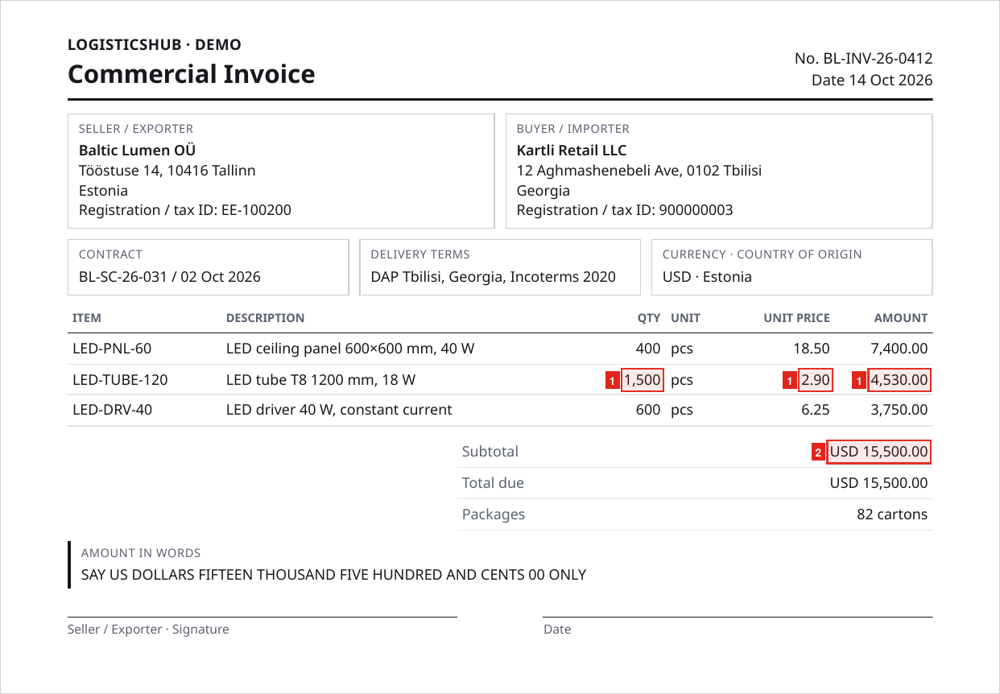

## What it does

`logisticshub` compares the documents of one shipment (commercial invoice, packing list, CMR and sales contract) with each other, and checks each one on its own. It reports every discrepancy its rules find, with the verbatim quote and the page it came from.

It never corrects a document and never guesses. Your agent only reads: from each PDF or page image it writes down every fact exactly as printed, with its quote and page. Everything after that is code. The checker first makes sure that each number and date is what its own quote says, and that each quote is printed on the page it cites. Then come exact decimal arithmetic, a parser that turns an amount written in words (English, Georgian, Russian, Turkish) into a number, and 17 fixed rules. Run it twice on the same extraction and you get the same report.

The output is a report in Markdown, HTML and JSON, in English, Georgian, Russian or Turkish. Each finding names the document, the page and the field, quotes the printed text, and ends with a line that says what to verify. Each PDF that has a finding also comes back as a copy with the findings boxed and numbered.

## When to reach for it

Ask your agent in plain words: "check the documents in this folder", "do the invoice and the CMR agree?". The skill is for the export or customs documents of one shipment. One invoice can be checked on its own too: its line totals, its sums and its amount in words. It is not for paying an invoice or booking it.

| Situation | What it finds |
|---|---|
| Before a shipment leaves | Quantities, packages and weights that differ between the invoice, the packing list and the CMR |
| Before the documents go to a bank or to the buyer | An amount in words that does not match the figures, line totals and subtotals that do not add up |
| Before customs | A CMR that lacks required particulars, a sea-only Incoterms rule on a road shipment, CIF or CIP with neither an insurance policy nor an insurance amount |
| Reviewing a supplier's set | Wrong or missing references between the documents, dates in the wrong order, a seller or buyer named differently |

## What it checks

- **Amounts.** The amount in words equals the amount in figures, currency included. Quantity × price equals each line total. The line totals add up to the subtotal, and the subtotal with discount, freight, insurance, other charges and tax gives the total. Invoice and contract are in one currency.
- **Quantities and weights.** Packing-list and CMR lines add up to their totals. Invoice and packing list give the same quantity per item, and invoice, packing list and CMR the same number of packages. Gross weight is not below net weight, and the weights are the same on every document.
- **References and parties.** The packing list cites the invoice's number and date, the invoice cites the contract's, and the CMR lists both among its attached documents. Contract date ≤ invoice date ≤ taking over of the goods. The same seller, buyer and consignee on every document. An invoice, a packing list and a CMR in the set.
- **Terms and the CMR.** The same Incoterms 2020 rule on invoice and contract, no sea-only rule on a road shipment, insurance under CIF or CIP, and the particulars the CMR Convention requires in Art. 6(1)(a)–(k).
- **Customs codes.** HS-01 checks printed HS codes on invoices dated 2024-01-26 or later when Georgia is the recorded country of the seller, buyer or consignee. An unreadable code gives a warning. A missing six-digit subheading gives a warning and the nearest heading when available. An absent eleven-digit code under a known subheading gives an error and up to five related codes. Other lengths from six to twelve are checked at six digits.

The checker and lookup use the original annex to the Georgian Minister of Finance’s Order No. 21 of 26 January 2024, in force that day and published 30 January 2024 ([Matsne document 6086072, publication 0](https://matsne.gov.ge/ka/document/download/6086072/0/1)). Later amendments were not verified. Normative texts are not protected by copyright in Georgia ([Law on Copyright and Related Rights, Art. 8(1)(a)](https://matsne.gov.ge/ka/document/view/16198)).

Search by exact code, prefix or Georgian description with `logisticshub hs 940330`, `logisticshub hs "საწერი მაგიდ"`, the skill’s `hs` subcommand or the MCP tool `lookup_hs_code`.

Each rule is stated exactly, with every finding, its severity and its tolerance, in the [rules reference](https://github.com/tsirbiladze/logisticshub/blob/main/skills/logisticshub/references/rules.md).

## It's working if

- Every finding cites a quote you can find, word for word, on the page it names.
- Documents that agree give "Errors: 0 · Warnings: 0", not a list of nitpicks.
- Running it again on the same extraction gives the same report.
- Where something cannot be read for certain (an amount in words with a typo, for example), you get a warning that says so, not a guess.
- A quote or a page number your agent got wrong does not pass unseen: every quote the checker does not find on its PDF page is listed after the report.

## Limits

How it reads:

- One run checks one shipment. The documents of several shipments are checked one run at a time.
- Scans: a page without a text layer is read from its picture. Nothing on it can be marked and no quote on it can be looked up; the notes say so.
- Page images (JPG, PNG) are read, never marked, and their quotes are not looked up.
- An amount in words is read in English, Georgian, Russian and Turkish. In any other language you get a warning that it could not be read.
- The Python checker writes the same reports but reads no PDFs: no marked copies, and no quote is looked up.

Not checked:

- **Incoterms place and edition**: recorded, not compared. Whether the named place suits the rule is not judged.
- **Contract value and goods**: the invoice total against the contract value, unit prices against the contract, the contract's goods against the invoice lines.
- **Volumes across documents**: a packing list's volumes are added up to its own total, not compared with the CMR.
- **Weights per line across documents**, and net weight on a CMR.
- **Origin and tariff classification**: origin is recorded only. Classification, duty and tax calculations, other countries’ nomenclatures and customs declarations are outside the check. HS-01 skips invoices without a confirmed Georgian party or usable date, and invoices dated before 2024-01-26.
- **Addresses, countries, registration and tax numbers, bank details, signatures and stamps**. Only the parties' names are compared, and not across scripts. HS-01 reads countries to decide whether it applies.
- **Tax**: the rate, whether tax is due, and tax included in the prices. A printed tax amount is only added into the invoice total.
- **A discount printed only as a rate**: the invoice total is then left unchecked.
- **Units**: nothing is converted. Quantities in different units are not compared, and neither are package counts of different packing methods.
- **Other dates**: delivery and payment terms, validity, the packing list's date.
- **Further documents of a type**: a second invoice, packing list, CMR or contract is checked on its own, but the rules that compare documents (QTY-01, WGT-02, REF-01, DATE-01, PTY-01) use the first of each type. The report says when there are more.
- **Other document types**: a bill of lading, certificate of origin, insurance policy or specification is not read. Only its title counts, for the insurance check.
- **The documents against reality**: the goods actually loaded, whether a document is genuine, and whether the extraction left out something the document prints.

## Where it fits

There are three ways to run it, all built on the same checker:

- **The skill** runs inside your agent (Claude Code, Codex, Cursor, claude.ai and others). Your agent reads the documents with its own model, and the check runs where the agent runs: on your machine, or on claude.ai, where the skill's instructions call for its Python checker.
- **The CLI** (`logisticshub` on npm) reads the documents with a model you choose, using your own API key, one document per file. It also checks an extraction you already have, without a model. Use it in scripts or without an agent.
- **The MCP server** (`logisticshub mcp`) gives any MCP client the extraction guide, the check and the Georgian HS lookup.

The skill's checker and the CLI end with exit code 0 when the documents were checked, with or without findings; 1 when the check is not complete and the reports say why; 2 when nothing was checked.

Logisticshub has no server, so nothing is sent to it. With the CLI, the documents go to the model provider you choose. All companies, people and numbers in the demo documents are fictional.
